[English](README.md) · **עברית**

# StellarCortex

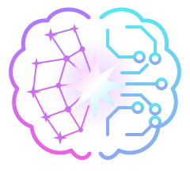

**סביבת עבודה של עמיתי AI בקוד פתוח, בהתקנה עצמאית על Linux, בהשראת Grok Bot.**

גרסה **0.1.2** · [רישיון MIT](LICENSE) · [github.com/avitwil/stellarcortex](https://github.com/avitwil/stellarcortex) · אתר: [stellarcortex.avitwil.io](https://stellarcortex.avitwil.io)

יוצרים בוטים לפי הצורך, משוחחים איתם, נותנים להם לחלק עבודה ביניהם ועוקבים אחרי השיחות והתוצאות. לכל בוט אפשר לבחור ספק ומודל משלו: חשבון אצל ספק, מפתח API, או שרת מודל מקומי שכבר רץ אצלכם.

**תוכן:** [יכולות](#features) · [דרישות](#requirements) · [התקנה](#installation) · [דרכים להפעלה](#ways-to-run) · [הפעלה ראשונה](#first-run) · [חשבונות ומודלים](#models) · [תנאי הספקים](#provider-terms) · [כלים וקול](#tools) · [מחשבים לבוטים](#computer) · [הגדרות](#configuration) · [נתונים ואבטחה](#data) · [עדכון](#updating) · [פתרון תקלות](#troubleshooting) · [תיעוד](#documentation) · [פיתוח](#development) · [רישיון](#license)

<a id="features"></a>
## יכולות

### בוטים שמדברים איתם

יוצרים בוטים לפי הצורך, ואפשר לערוך, למחוק ולשחזר אותם. לכל בוט יש זיכרון, קבצים, מיומנויות ושגרות משלו. את הספק, המודל, מאמץ החשיבה והמהירות של כל בוט בוחרים בבורר שליד תיבת ההודעה, במידה שהספק והמודל תומכים בהם. השינוי חל על המשימה הבאה. כשבוט צריך החלטה שלכם, השיחה מציגה אותה וממתינה.

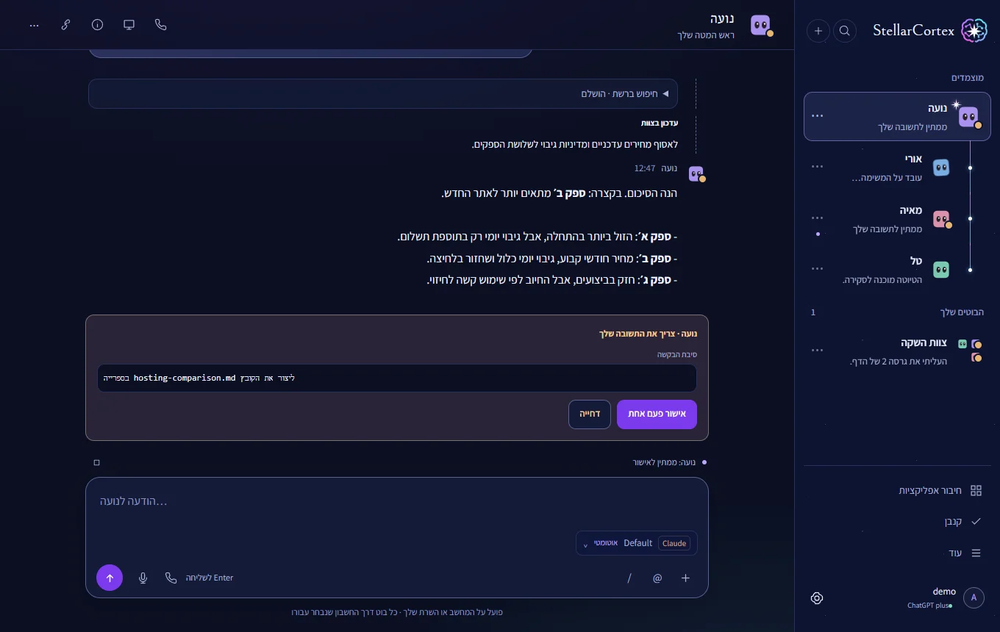

כדי להתחיל, לחצו על **+** בראש סרגל הצד ובחרו **בוט חדש**, או בקשו מהבוט הקיים ליצור בוט נוסף.

### צוותים והעברת משימות

בוט יכול להרכיב צוות משלו ולהעביר עבודה לחברי הצוות. הצוות מוצג כעץ בסרגל הצד, ואפשר לקרוא כל התכתבות בין הבוטים. בשיחה קבוצתית משתתפים 2 עד 6 בוטים: לחצו על **+**, בחרו **שיחה קבוצתית חדשה** וסמנו את החברים.

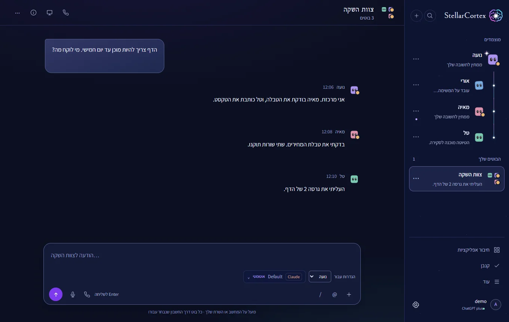

כדי להעביר משימה פשוט מבקשים: "תרכיב צוות להשקה הזאת ותעביר את המחקר לבוט חדש". החסימה אחרי תוכן חיצוני עוברת גם עם המשימה, כמתואר ב[נתונים ואבטחה](#data).

### קנבן

לוח כללי ולוחות לפרויקטים, עם שלבי משימות ורעיונות, ניתוב לבוטים, שערי אישור, השהיה והמשך. פותחים את **קנבן** בסרגל הצד ולוחצים על **+** כדי להוסיף כרטיס. עבודה של בוט על כרטיס מתחילה רק כשמפעילים אותה, וניתוב שלבים אוטומטי חל רק על משימות שבחרתם.

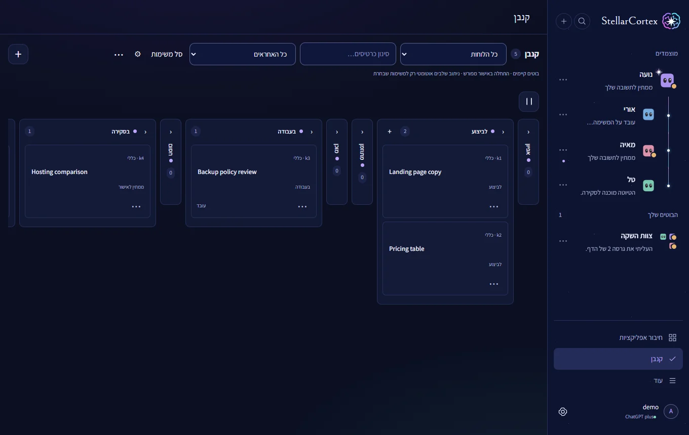

### אפליקציות וכלים

**חיבור אפליקציות** מוסיף שרתי MCP ואת מחבר Google ‏(Gmail,‏ Drive,‏ Docs,‏ Sheets,‏ Calendar ו־Contacts). החיבורים האלה נפרדים מספק המודלים. פרטים ב[כלים ושיחה קולית](#tools).

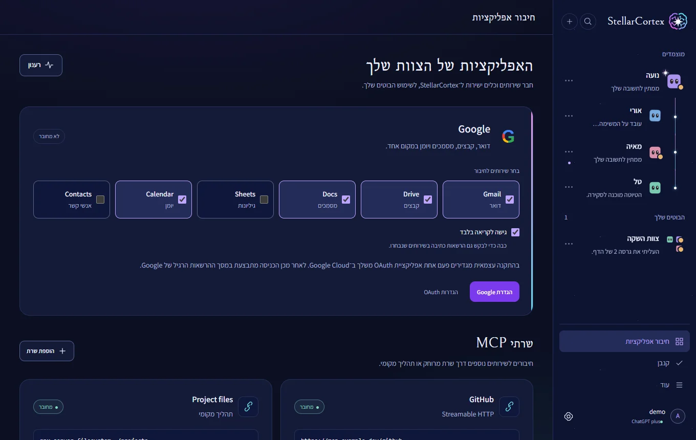

### חיבורי ספקים

כל בוט יכול להשתמש בחיבור משלו: חשבון אצל ספק, מפתח API, או שרת מודל מקומי שכבר רץ אצלכם. ב**הגדרות ← כללי** נמצאות ההתחברויות לחשבונות, וב**הגדרות ← מודלים וחיבורים** נמצאים ספקי API ומודלים מקומיים. פרטים ב[חשבונות ומודלים](#models). לפני חיבור כלשהו קראו את [תנאי הספקים](#provider-terms).

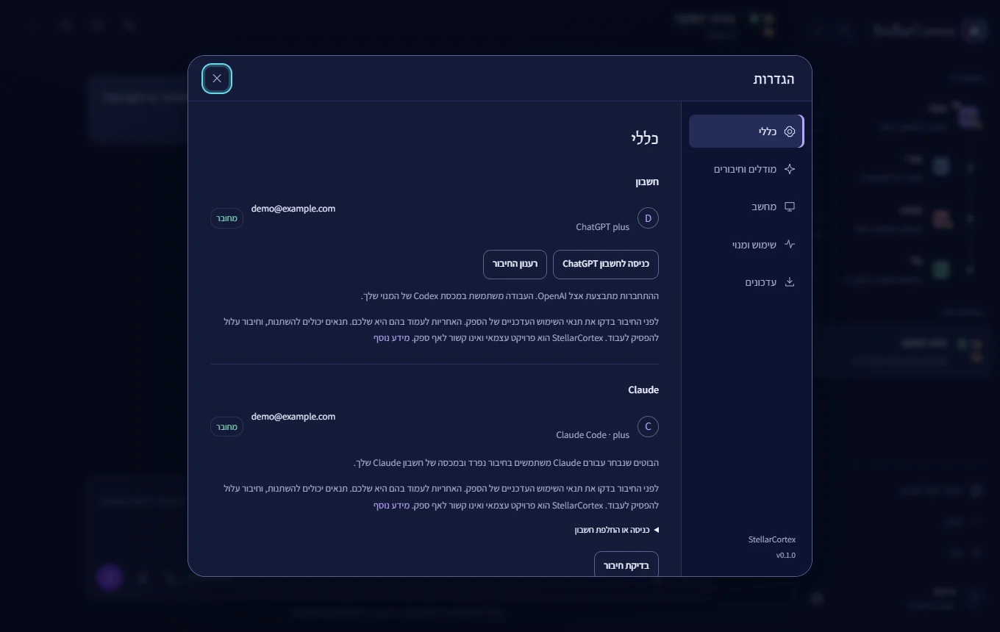

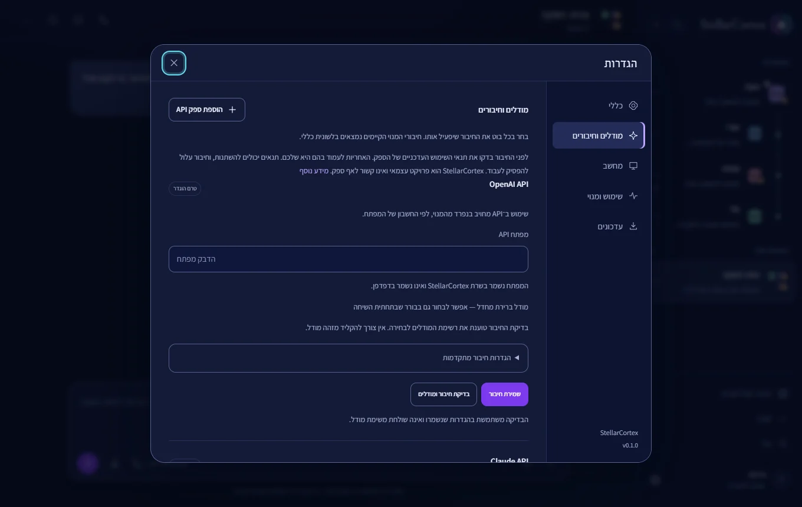

### מחשב לכל בוט

כל הבוטים חולקים מחשב וירטואלי אחד, ולכל בוט יש בו משתמש ושולחן עבודה משלו. אפשר לצפות במסך של בוט, לקחת שליטה ולהחזיר אותה. את המצב של כל בוט בוחרים ב**הגדרות ← מחשב**. השיחה אינה תלויה במחשב. פרטים ב[מחשבים לבוטים](#computer).

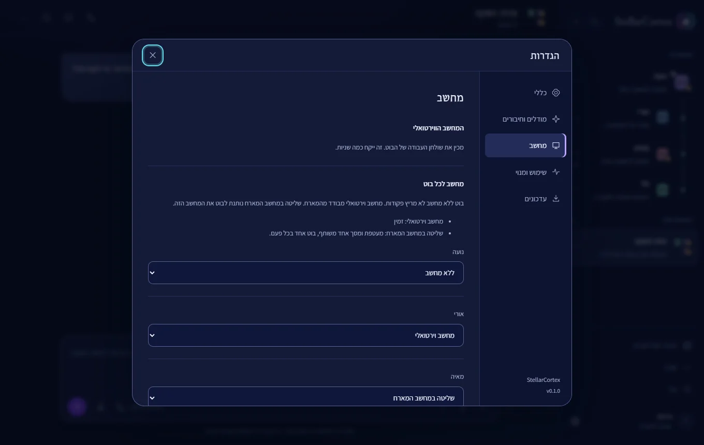

### שלושה עיצובים

בוחרים **מצפה כוכבים**, **אור יום** או **חדר בקרה** ב**הגדרות ← כללי ← מראה ושפה**, במצב בהיר או כהה, בעברית או באנגלית.

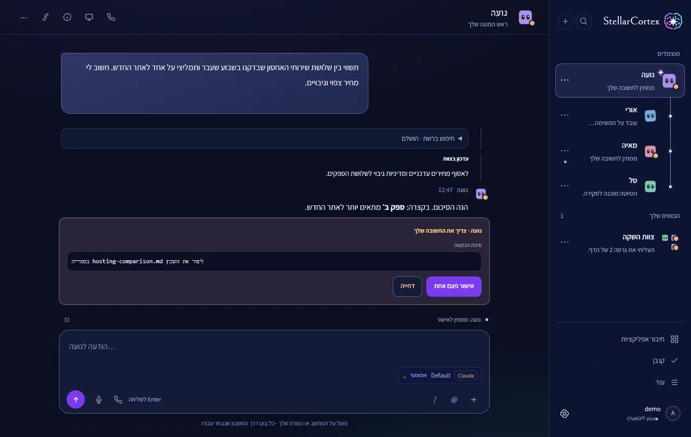

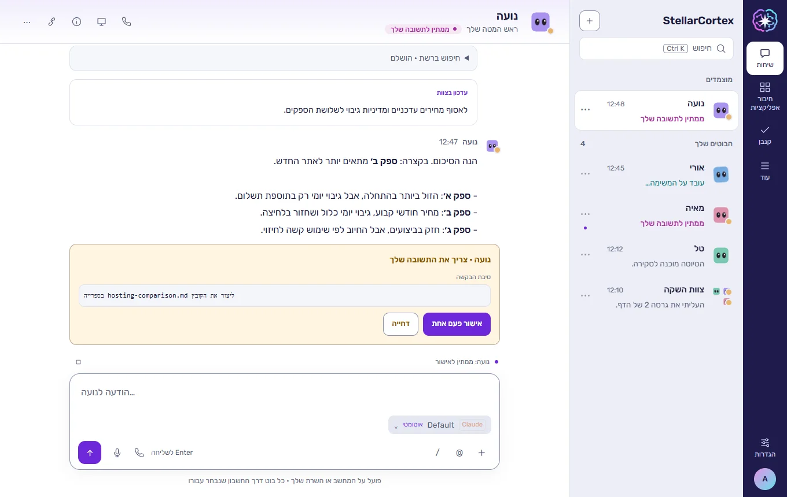

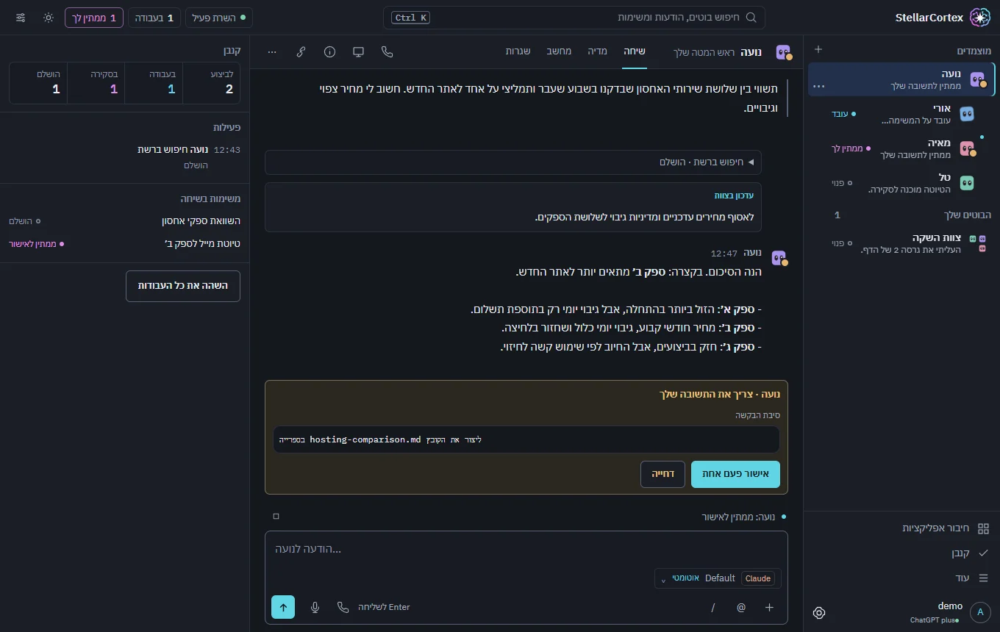

### עוד בכלי

- זיכרון, קבצים, ספרייה, מיומנויות, שגרות ו־Webhooks. שגרות רצות כל עוד השרת פועל.
- דפדפן קבוע לכל בוט.
- שיחה קולית עם בוט דרך המיקרופון, בדפדפנים תומכים.

StellarCortex מיועד לבעלים אחד, ואינו פלטפורמה מרובת משתמשים. מה שבוט מסוגל לעשות תלוי במודל, בכלים ובהרשאות: כלים דורשים מודל עם קריאה לכלים, ומסכים ותמונות דורשים מודל ראייה.

<a id="requirements"></a>
## דרישות

| דרישה | פירוט |
| --- | --- |
| מערכת הפעלה | **Linux.** גרסה 0.1 תומכת ב־Linux בלבד, וגרסה ל־Windows מתוכננת. ההוראות מיועדות ל־Debian ול־Ubuntu. |
| Node.js ו־npm | **Node.js 22.16 ומעלה** עם npm, מ־[nodejs.org](https://nodejs.org/). |
| אינטרנט | להתקנה, ולשימוש בספקי ענן ובכלים מקוונים. |
| גישה למודל | לפחות אחד מאלה: חשבון אצל ספק, מפתח API, או שרת מודל מקומי פעיל. |
| דפדפן | דפדפן שולחני עדכני. שיחה קולית דורשת גם הרשאת מיקרופון ומצב שמע נתמך. |

אילו מודלים, מגבלות ותנאים חלים על חשבון נקבע על ידי הספק, וזה יכול להשתנות. שימוש ב־API מחויב בנפרד, ו־StellarCortex לעולם אינו עובר בעצמו ממנוי לחיוב API. ל־Claude Code יש [דרישות מערכת](https://code.claude.com/docs/en/setup) משלו.

ההתקנה אינה מוסיפה שרת מודלים ואינה מורידה משקולות של מודלים. הבוטים עונים אחרי שמחברים מודל.

<a id="installation"></a>
## התקנה

הריצו את הפקודה כמשתמש הרגיל שלכם, לא כ־root:

```bash
curl -fsSL https://stellarcortex.avitwil.io/install.sh | bash
```

היא מורידה את הגרסה האחרונה אל `~/stellarcortex`, בודקת את החתימה, מתקינה הכול ומדפיסה קישור אחד שפותח את האפליקציה כשאתם כבר מחוברים. היא מבקשת את סיסמת `sudo` פעם אחת, ושואלת שאלה אחת אם יש במארח חומת אש. המחשב הווירטואלי נבנה אחר כך ברקע: האפליקציה עובדת בינתיים, וההתקדמות מוצגת ב**הגדרות ← מחשב**. מארח שלא יכול להריץ את המחשב מסיים בלעדיו ואומר למה.

כדי לבחור הגדרות, כתבו אותן לפני `bash`, כמו בדוגמאות ב[דרכים להפעלה](#ways-to-run). כדי להתקין במקום אחר, הגדירו את `STELLARCORTEX_INSTALL_DIR`.

החתימה מכסה את מה שהסקריפט מתקין, לא את הסקריפט עצמו. כדי לבדוק אותו קודם, הורידו אותו והשוו את ה־SHA-256 שלו לזה שבהערות הגרסה.

### Node.js

המתקין צריך Node.js 22.16 ומעלה, לכל המערכת. אם Node.js חסר, הוא מנסה את החבילה של ההפצה. אם החבילה ישנה מדי, כמו ב־Ubuntu 24.04, הוא עוצר ואומר זאת: התקינו קודם את Node.js, כמו ב[שלב 3 בדוגמה לשרת VPS](#run-vps).

### מקוד המקור

```bash
git clone https://github.com/avitwil/stellarcortex.git && cd stellarcortex && bash install.sh --service
```

כדי לעבוד בלי שירות, הריצו `bash install.sh` ואז `bash start.sh`, או `bash start.sh --no-open` בשרת. אם Chromium מדווח על ספריות מערכת חסרות, הריצו `sudo npx playwright install-deps chromium` בתיקיית האפליקציה.

### Docker

```bash
docker compose up -d --build
docker compose exec stellarcortex cat /data/access-key
```

פתחו את http://127.0.0.1:4317 והזינו את המפתח. הקונטיינר מריץ את השרת בלבד, בלי שולחן עבודה, ומפרסם את הפורט על localhost. התקנת Docker עוד לא נבדקה מקצה לקצה.

<a id="ways-to-run"></a>
## דרכים להפעלה

| | [במחשב Linux שלכם](#run-local) | [בשרת VPS דרך Tailscale](#run-vps) | [ברשת מקומית](#run-lan) |
| --- | --- | --- | --- |
| גישה מתוך | אותו מחשב | המכשירים שלכם ב־tailnet | מכשירים ברשת שלכם |
| חיבור | Localhost | HTTPS בתוך ה־tailnet | HTTP רגיל |
| בוטים, שיחות, קנבן, דפדפן, חיבורים | כן | כן | כן |
| מיקרופון וחלון ההתחברות לאתרים | כן | כן | לא: שניהם צריכים HTTPS או localhost |
| מחשב וירטואלי | אם המארח עובר את ה[בדיקה](#computer-check) | רק אם השרת עובר אותה, ורבים לא עוברים | אם המארח עובר אותה |

**לעולם אל תחשפו את הפורט לאינטרנט הציבורי.** אל תעבירו את פורט 4317 בנתב ואל תפתחו אותו בחומת אש של ספק ענן. לאפליקציה אין TLS משלה, ומפתח גישה אחד פותח את כל סביבת העבודה. בשרת עם כתובת ציבורית השאירו את `STELLARCORTEX_BIND` לא מוגדר, כדי שהאפליקציה תישאר על `127.0.0.1`.

<a id="computer-check"></a>
### בדיקת המארח למחשב הווירטואלי

המחשב הווירטואלי צריך מארח Intel או AMD של 64 סיביות עם KVM, לפחות 10 GiB זיכרון, ‏90 GiB פנויים תחת `/var/lib`,‏ `apt-get` ו־systemd. בתוכניות VPS רבות אין KVM מקונן, או שיש פחות זיכרון. בדקו לפני שאתם בוחרים תוכנית, או במארח עצמו:

```bash
uname -m           # must print x86_64
ls -l /dev/kvm     # the file must exist
free -m            # "total" on the Mem line: 10240 or more
df -BG /var/lib    # "Avail": 90G or more
```

במארח שלא עובר את הבדיקה ההתקנה מסתיימת בלי המחשב הווירטואלי ואומרת למה. הבוטים עדיין משוחחים ומשתמשים בדפדפן, בזיכרון, בקבצי הספרייה, בחיבורים ובקנבן. אין להם מעטפת ושולחן עבודה, ושלב אימות בקנבן צריך בוט עם מחשב. יש גם שליטה במחשב המארח, אבל היא מריצה בוט כמשתמש של השרת עצמו, לכן קראו את [מחשבים לבוטים](#computer) לפני שאתם מפעילים אותה. אם תתקנו את הסיבה בהמשך, הריצו שוב `bash install.sh --service`.

אם יש במארח חומת אש, ההתקנה שואלת פעם אחת ומוסיפה כללים לגשר של המחשב בלבד. הכללים שלכם ו־SSH נשארים כמו שהם. אם תענו לא, ההתקנה מסתיימת בלי המחשב.

<a id="run-local"></a>
### 1. במחשב Linux שלכם

```bash
curl -fsSL https://stellarcortex.avitwil.io/install.sh | bash
```

פתחו את הקישור שמודפס. השירות ממשיך לרוץ אחרי התנתקות ועולה עם המחשב. כדי לפתוח את האפליקציה שוב, הריצו `node scripts/open.mjs` בתיקיית האפליקציה. כדי לראות את מצב השירות, הריצו `systemctl --user status stellarcortex`.

<a id="run-vps"></a>
### 2. בשרת VPS, בגישה דרך Tailscale

הדוגמה כאן משתמשת בשרת VPS של [Hostinger](https://www.hostinger.com/vps-hosting) וב־[Tailscale](https://tailscale.com/). שתיהן אפשרויות שאפשר להמליץ עליהן להקמה כזאת, ואף אחת מהן אינה קשורה ל־StellarCortex. כל שרת VPS עם Debian או Ubuntu יכול לעבור את אותם שלבים. בדקו בעצמכם את התוכניות, המחירים והתנאים העדכניים שלהן.

האפליקציה נשארת על `127.0.0.1` ועל socket פרטי, כך שלא נפתח עבורה שום פורט. ‏Tailscale נותן למכשירים שלכם כתובת HTTPS.

1. צרו שרת VPS עם Ubuntu ורשמו את הכתובת הציבורית שלו. אם אתם רוצים את המחשב הווירטואלי, בחרו תוכנית שעוברת את ה[בדיקה](#computer-check).

2. צרו משתמש רגיל. האפליקציה לא צריכה לרוץ כ־root.

   ```bash
   ssh root@your-server-ip
   adduser stellar
   usermod -aG sudo stellar
   ```

   אם אתם מתחברים עם מפתח SSH, העתיקו אותו למשתמש החדש:

   ```bash
   install -d -m 700 -o stellar -g stellar /home/stellar/.ssh
   install -m 600 -o stellar -g stellar ~/.ssh/authorized_keys /home/stellar/.ssh/
   ```

   אחר כך הריצו `exit`, והתחברו שוב עם `ssh stellar@your-server-ip`. התחברו ישירות, לא דרך `su`: השירות צריך את סשן המשתמש ש־SSH מפעיל.

3. התקינו את Node.js אם `node --version` לא מציג כלום או מציג גרסה נמוכה מ־22.16. הדוגמה משתמשת בחבילות של NodeSource:

   ```bash
   sudo apt-get update && sudo apt-get install -y curl
   curl -fsSL https://deb.nodesource.com/setup_22.x -o nodesource_setup.sh
   sudo bash nodesource_setup.sh
   sudo apt-get install -y nodejs
   ```

4. התקינו את Tailscale בשרת והתחברו דרך הקישור שהוא מדפיס:

   ```bash
   curl -fsSL https://tailscale.com/install.sh | sh
   sudo tailscale up
   ```

   במסוף הניהול של Tailscale, בדף DNS, הפעילו את **MagicDNS** ואת **HTTPS Certificates**. התקינו את Tailscale גם במחשב הנייד או בטלפון, עם אותו חשבון.

5. מצאו את שם השרת ב־tailnet. השמיטו את הנקודה שבסוף.

   ```bash
   tailscale status --json | grep -m1 '"DNSName"'
   ```

6. התקינו את StellarCortex עם השם הזה:

   ```bash
   curl -fsSL https://stellarcortex.avitwil.io/install.sh | STELLARCORTEX_TAILNET_UI_URL=https://your-machine.your-tailnet.ts.net/ bash
   ```

7. הריצו את פקודת `tailscale serve` שההתקנה מדפיסה. עם תיקיית הנתונים הרגילה היא:

   ```bash
   sudo tailscale serve --bg --https=443 unix:/home/stellar/.stellarcortex/tailscale-ui.sock
   ```

8. פתחו את הקישור שמודפס במכשיר שנמצא ב־tailnet, ושמרו אותו בסוד. הוא עובד רק בתוך ה־tailnet.

התחברו לספקים בשרת, באותו משתמש. פרטים ב[חשבונות ומודלים](#models).

**כבר התקנתם בלי Tailscale?** בצעו את שלבים 4 ו־5, ואז הריצו את זה בשרת. הפקודה מפעילה מחדש את השירות, ולכן משימות שרצות נעצרות, ומדפיסה את הפקודה של שלב 7 ואת הקישור של שלב 8.

```bash
cd ~/stellarcortex
STELLARCORTEX_TAILNET_UI_URL=https://your-machine.your-tailnet.ts.net/ bash install.sh --service
```

**בלי Tailscale.** דלגו על שלבים 4, 5 ו־7, התקינו בפקודה הרגילה, ופתחו מנהרת SSH מהמחשב שלכם. אחר כך גלשו אל http://127.0.0.1:4317 והזינו את [מפתח הגישה](#first-run).

```bash
ssh -N -L 4317:127.0.0.1:4317 stellar@your-server-ip
```

<a id="run-lan"></a>
### 3. ברשת מקומית

מתאים לגישה ממכשירים אחרים בבית או במשרד קטן. זה HTTP רגיל, כך שכל מי שברשת יכול לקרוא את התעבורה, כולל את מפתח הגישה. השתמשו בזה רק ברשת שאתם סומכים עליה. ל־HTTPS עברו באותו מחשב את שלבי Tailscale.

1. מצאו את כתובת השרת, ושריינו אותה בנתב כדי שלא תשתנה. השירות מאזין בדיוק על הכתובת הזאת, והוא כבר לא עונה על `127.0.0.1`.

   ```bash
   hostname -I
   ```

2. התקינו עם הכתובת הזאת, כאן לדוגמה `192.168.1.50`:

   ```bash
   curl -fsSL https://stellarcortex.avitwil.io/install.sh | STELLARCORTEX_BIND=192.168.1.50 STELLARCORTEX_PUBLIC_URL=http://192.168.1.50:4317 bash
   ```

3. אם יש במארח חומת אש, אפשרו גישה רק מהרשת שלכם. עם `ufw`:

   ```bash
   sudo ufw allow from 192.168.1.0/24 to any port 4317 proto tcp
   ```

4. פתחו את הקישור שמודפס ממכשיר אחר. בלי `STELLARCORTEX_PUBLIC_URL` השרת עונה "Host is not configured".

<a id="start-stop"></a>
### הפעלה וכיבוי

ההתקנה מוסיפה בלינוקס את הפקודה `stcortex`.

| פקודה | מה היא עושה |
| --- | --- |
| `stcortex --start` | מפעילה עכשיו, יחד עם המחשב הווירטואלי. לא משנה מה קורה באתחול. |
| `stcortex --stop` | עוצרת עכשיו ומכבה את המחשב הווירטואלי בצורה מסודרת. הבוטים והנתונים נשמרים. אם מוגדרת הפעלה באתחול, היא עדיין תתבצע. |
| `stcortex --enable` | מפעילה עכשיו, יחד עם המחשב הווירטואלי, ומגדירה את שניהם להפעלה באתחול, בלי צורך בכניסה למשתמש. |
| `stcortex --disable` | עוצרת את שניהם עכשיו ומבטלת את ההפעלה שלהם באתחול. |

`--enable` ו־`--disable` קובעות את המתג **הפעלה אחרי אתחול** ב**הגדרות ← מחשב**, כך שההגדרות מציגות את התוצאה. `--start` ו־`--stop` לא משנות אותו.

<a id="change-settings"></a>
### שינוי ההגדרות האלה בהמשך

הריצו שוב את ההתקנה עם ההגדרה החדשה. היא מפעילה מחדש את השירות, ולכן משימות שרצות נעצרות, וזה לוקח דקה או שתיים. הגדרות שלא חזרתם עליהן נשארות כמו שהיו. הן נשמרות ב־`~/.config/systemd/user/stellarcortex.service.d/install.conf`.

```bash
cd ~/stellarcortex
STELLARCORTEX_TAILNET_UI_URL=https://your-machine.your-tailnet.ts.net/ bash install.sh --service
```

על תיקיית הנתונים והפורט קראו ב[מדריך הפריסה](docs/DEPLOYMENT.md#linux-service).

<a id="first-run"></a>
## הפעלה ראשונה ומפתח הגישה

פתחו את הקישור שההתקנה הדפיסה. כדי לפתוח את האפליקציה שוב, הריצו `node scripts/open.mjs` בתיקיית האפליקציה.

אם מתבקש מפתח, הוא נמצא ב־`~/.stellarcortex/access-key`, או ב־`/data/access-key` ב־Docker.

**זהו מפתח הגישה ל־StellarCortex, לא מפתח API.** הוא פותח את כל סביבת העבודה ואת החיבורים שלה, לכן שמרו אותו בסוד.

התקנה חדשה מתחילה עם בוט אחד בשם **Stellar**. חברו ספק בהגדרות, ואז שלחו לו הודעה.

<a id="models"></a>
## חשבונות ומודלים

<a id="provider-terms"></a>
### תנאי הספקים

**בדקו את תנאי הספק לפני החיבור.** ‏StellarCortex יכול להתחבר לחשבונות ולשירותים של חברות אחרות. לפני שאתם מחברים חשבון, מנוי או מפתח API של ספק כלשהו, בדקו בעצמכם את תנאי השימוש העדכניים של אותו ספק. האחריות לעמוד בהם היא שלכם.

תנאים יכולים להשתנות בכל עת, וחיבור שעובד היום עלול להפסיק לעבוד. ‏StellarCortex אינו אומר שהשימוש בחשבון או במנוי של ספק כלשהו מותר, ואינו מבטיח שחיבור כלשהו ימשיך לעבוד.

‏StellarCortex הוא פרויקט עצמאי. הוא אינו קשור לאף ספק ואינו מאושר על ידי ספק כלשהו, וכל שמות המוצרים שייכים לבעליהם. התוכנה מסופקת "כפי שהיא" (as is), ללא אחריות מכל סוג, כמפורט ב[רישיון MIT](LICENSE).

### חיבור ספק

מתחברים **בסביבה שבה השרת רץ ובאותו משתמש מערכת.** התחברות במחשב האישי אינה עוברת לשרת מרוחק או לקונטיינר.

**ChatGPT / Codex.** הכלי יכול להשתמש בחשבון ChatGPT דרך לקוח Codex. ב**הגדרות ← כללי** בוחרים **התחברות עם ChatGPT**, או מריצים בתיקיית האפליקציה `node node_modules/@openai/codex/bin/codex.js login --device-auth`. ההתחברות מתבצעת אצל OpenAI.

**Claude ‏(Claude Code).** הכלי יכול להריץ את לקוח Claude Code עם החשבון שלכם. ב**הגדרות ← מודלים וחיבורים** לוחצים על **חיבור Claude**, משלימים את ההתחברות ובוחרים Claude בבורר הספק של הבוט. אפשר גם להריץ **`bash claude-login.sh`** בטרמינל ואז לרענן את חיבור Claude בהגדרות. ראו את [הערת תנאי הספק](#provider-terms). ‏Claude Code הוא תלות אופציונלית ש־npm מוריד במחשב שלכם, בכפוף לתנאים שלו. פרטים ב[מדריך Claude](docs/CLAUDE.he.md).

**ספקי API ומודלים מקומיים.** ב־**Settings ← Models & connections ← Add API provider** בוחרים תבנית מוכנה (OpenAI,‏ Anthropic,‏ NVIDIA,‏ OpenCode ועוד) או כתובת מותאמת בפורמט Chat Completions,‏ Responses או Anthropic Messages, ומזינים את המפתח. למודל מקומי בוחרים **Ollama,‏ llama.cpp,‏ LM Studio או vLLM** ומזינים את הכתובת של שרת שכבר פועל. הכתובת צריכה להיות נגישה **מהשרת של StellarCortex**: בתוך Docker, ‏`localhost` הוא הסביבה הזו עצמה. חיבורים שאתם מגדירים יכולים להשתמש בכתובות loopback,‏ LAN ו־tailnet; כתובות metadata של ענן נחסמות תמיד. פרטים ב[מדריך API ומודלים מקומיים](docs/API-LOCAL.he.md).

את המודל, המאמץ והמהירות של כל בוט בוחרים בבורר שליד תיבת ההודעה; השינוי חל על המשימה הבאה. פרטים ב[מדריך הגדרות המודל](docs/MODELS.he.md).

<a id="tools"></a>
## כלים ושיחה קולית

**Connect apps** מוסיף שרתי MCP דרך Streamable HTTP,‏ SSE או תוכנת stdio שמותקנת מקומית, בלי אימות, עם מפתח או כותרת, או עם OAuth. שרתי HTTP ו־SSE יכולים להיות ב־loopback, ב־LAN או ב־tailnet; כתובות metadata של ענן נחסמות תמיד. מחבר Google כולל את Gmail,‏ Drive,‏ Docs,‏ Sheets,‏ Calendar ו־Contacts, ודורש לקוח OAuth משלכם ב־Google. פרטים ב[מדריך החיבורים](docs/CONNECTIONS.he.md).

את השפה בוחרים ב־**Settings ← General ← Language**. כפתור השיחה פותח שיחה קולית עם הבוט שנבחר, באמצעות זיהוי הדיבור וההקראה של הדפדפן או OpenAI Realtime (דורש מפתח API ומחויב בנפרד). נדרשת הרשאת מיקרופון, דרך localhost או HTTPS. פרטים ב[מדריך הקול](docs/VOICE.he.md).

<a id="computer"></a>
## מחשבים לבוטים

כל הבוטים חולקים מחשב וירטואלי אחד, אורח Ubuntu על QEMU/KVM, ולכל בוט יש בו משתמש ושולחן עבודה משלו. השיחה אינה תלויה במחשב: בוט עונה גם בזמן שהמחשב נבנה או מופעל מחדש. הזיכרון של המחשב מגביל כמה בוטים יקבלו שולחן עבודה, ובוט מעבר למגבלה ממשיך לשוחח כרגיל. המחשב עולה לבד אחרי אתחול של המארח, אלא אם מכבים זאת ב**הגדרות ← מחשב**.

את המצב של בוט בוחרים ב**הגדרות ← מחשב**, כשאין לו עבודה פעילה.

| מצב | מה הבוט מקבל |
|---|---|
| **ללא מחשב** | דפדפן, זיכרון, קבצי ספרייה וחיבורים. בלי מעטפת ובלי שולחן עבודה. |
| **מחשב וירטואלי** | מעטפת, קבצים, דפדפן ושולחן עבודה בתוך האורח, כמשתמש נפרד בלי הרשאות. |
| **שליטה במחשב המארח** | מעטפת ומסך במחשב הזה. **הבוט רץ כמשתמש המערכת של השרת, ולכן יכול לקרוא מפתחות פרטיים, את מפתח הגישה ועוגיות דפדפן.** השתמשו בזה רק אם אתם מקבלים את זה. |

במציג המחשב, הגדילו את המסך, בחרו **לקיחת שליטה** כדי להשתמש בעכבר ובמקלדת, ו**סיימתי** כדי להחזיר את השליטה.

**התחברות לאתר.** כשבוט מגיע לדף התחברות, הוא יכול לבקש מכם להתחבר. חלון מציג את הכתובת האמיתית של האתר, והסיסמה עוברת לדף ואינה נשמרת. קראו את הכתובת לפני שאתם מקלידים. לעולם אל תקלידו סיסמה בשיחה.

פרטים ב־[COMPUTER.md](docs/COMPUTER.md).

<a id="configuration"></a>
## הגדרות

ההגדרות הן משתני סביבה. בהתקנה כשירות כתבו אותן לפני פקודת ההתקנה.

| משתנה | ברירת מחדל | מטרה |
| --- | --- | --- |
| `STELLARCORTEX_DATA_DIR` | `~/.stellarcortex` | תיקיית הנתונים: מצב, סביבת עבודה, פרופילי דפדפן, מפתח גישה, לוגים |
| `PORT` | `4317` | פורט HTTP |
| `STELLARCORTEX_BIND` | `127.0.0.1` | כתובת האזנה. היא לא מוסיפה TLS |
| `STELLARCORTEX_PUBLIC_URL` | אין | הכתובת שפותחים בדפדפן, מאחורי reverse proxy או ברשת מקומית. כתובת HTTPS מפעילה עוגיות מאובטחות |
| `STELLARCORTEX_TAILNET_UI_URL` | אין | כתובת ה־HTTPS שלכם ב־Tailscale |
| `CODEX_BIN`, `CLAUDE_BIN` | הלקוחות המצורפים | שימוש בקובץ הפעלה אחר של Codex או Claude Code |

על reverse proxy והקמות אחרות קראו ב[מדריך הפריסה](docs/DEPLOYMENT.md).

<a id="data"></a>
## נתונים ואבטחה

- התקנה אחת מיועדת לבעלים אחד. שמרו בסוד את מפתח הגישה, את תיקיית הנתונים ואת חשבון המערכת.
- הוראות מגיעות רק מכם או מבוטים אחרים בכלי. מיילים, פלט MCP, תוכן webhook, דפי אינטרנט ומסכי מחשב הם מידע. אחרי שבוט קורא אותם, פקודות מעטפת ושינויי קבצים חסומים באותה שיחה. כדי להריץ פקודות שוב, נקו את השיחה או עברו לשיחה אחרת. פרטים ב[הרשאות ועדכונים](docs/UPDATES.md).
- פקודות הרשאה כמו `sudo` נדחות לכל בוט, ככל שהאפליקציה מזהה אותן.
- פרטי הגישה לספקים מוצפנים בתיקיית הנתונים. התחברויות Codex ו־Claude נשמרות בידי הלקוחות שלהם.
- השרת מאזין על localhost. לגישה מרחוק השתמשו ב־Tailscale, במנהרת SSH או ב־reverse proxy עם HTTPS. ראו [דרכים להפעלה](#ways-to-run). לעולם אל תחשפו את הפורט לאינטרנט.
- **גיבוי:** עצרו את השרת והעתיקו את כל תיקיית הנתונים. הייצוא ל־JSON בממשק אינו גיבוי מלא.

<a id="updating"></a>
## עדכון

פתחו את **הגדרות ← עדכונים**. המסך בודק אם יש גרסה חדשה ומשווה אותה לגרסה שלכם. אם יש, הוא מציג את הגרסה ואת ההערות שלה וכפתור **עדכן עכשיו**, ואחר כך את ההתקדמות והתוצאה. אם הבדיקה נכשלת, הוא מציג את הסיבה וכפתור **בדוק עדכונים**.

האפליקציה בודקת את חתימת הגרסה מול מפתח שקבוע בהתקנה, ודוחה גרסה שנכשלת בבדיקה או שאינה חדשה יותר. היא מגבה את הנתונים, מפעילה את הגרסה החדשה ובודקת אותה. אם הבדיקה נכשלת, הגרסה והנתונים הקודמים חוזרים, וההגדרות מציגות למה. הנתונים וההתחברויות נשמרים. חלקי המערכת של המחשב הווירטואלי מתעדכנים באותו שלב.

אם הכפתור אינו זמין, כמו ב־Docker, ראו [שחזור](docs/RECOVERY.md).

<a id="troubleshooting"></a>
## פתרון תקלות

| בעיה | מה לבדוק |
| --- | --- |
| `node` או `npm` לא נמצאים | התקינו Node.js 22.16 ומעלה ופתחו מסוף חדש. |
| הממשק לא נפתח | הפעילו עם `bash start.sh`, ובדקו את `server.log` בתיקיית הנתונים. |
| פורט 4317 תפוס | עצרו את המופע האחר, או הגדירו `PORT` ו־`STELLARCORTEX_DATA_DIR` אחרים. |
| האפליקציה מבקשת מפתח | הריצו `node scripts/open.mjs`, או קראו את הקובץ `access-key`. בשרת מרוחק המפתח נמצא בשרת. |
| Codex או Claude מופיעים כמנותקים | התחברו בשרת באותו משתמש מערכת, בדקו זכאות ומכסה, ורעננו בהגדרות. |
| Chromium חסר או לא עולה | הריצו `node node_modules/playwright/cli.js install chromium`; ב־Debian/Ubuntu גם `sudo npx playwright install-deps chromium`. |
| לבוט אין שולחן עבודה | בדקו את המצב שלו ב**הגדרות ← מחשב**. שליטה במחשב המארח צריכה סשן X11. |
| המחשב נעצר עם "לא קיבל כתובת רשת" | חומת האש במארח חוסמת אותו. הריצו `sudo python3 /var/lib/stellarcortex/kit/deployment/ubuntu-desktop/network-coexistence.py --install`, ואז לחצו על **נסו שוב** ב**הגדרות ← מחשב**. |
| המודל המקומי לא נגיש | בדקו שהוא רץ ונגיש מהשרת. |
| חיבור MCP שמור אך לא פעיל | חברו אותו ב־Connect apps. שרתי MCP אינם מתחברים מחדש אוטומטית אחרי הפעלה מחדש. |
| המיקרופון או השמע לא עובדים | בדקו הרשאה, תמיכה בדפדפן ו־localhost/HTTPS. ‏Realtime דורש חיבור OpenAI API. |

‏`npm run doctor` בודק את ההתקנה ואת מצב החיבורים. הבדיקה אינה מוכיחה שמודל יענה; לשם כך שלחו הודעת בדיקה קצרה. עברו על הפלט לפני שאתם משתפים אותו.

<a id="documentation"></a>
## תיעוד

| מדריך | שפה |
| --- | --- |
| [פריסה: שירותים, SSH,‏ HTTPS,‏ Tailscale וגיבויים](docs/DEPLOYMENT.md) | אנגלית |
| [שליטה במחשב ומסכים נפרדים](docs/COMPUTER.md) · [מחשב Ubuntu משותף](docs/SHARED-DESKTOP.md) · [התקנת המארח](deployment/ubuntu-desktop/README.md) | אנגלית |
| [מצבי הרשאות ועדכונים](docs/UPDATES.md) | אנגלית |
| [מפת היכולות](docs/PARITY.md) · [בדיקות ואימות](docs/VALIDATION.md) · [מפת דרכים](docs/ROADMAP.md) · [המערכת החזותית](docs/DESIGN.md) | אנגלית |
| [הודעות צד שלישי ורישיונות](THIRD_PARTY_NOTICES.md) | אנגלית |
| [מודלים, מאמץ ומהירות](docs/MODELS.he.md) · [Claude Code ומדי שימוש](docs/CLAUDE.he.md) · [API ומודלים מקומיים](docs/API-LOCAL.he.md) · [MCP ו־Google](docs/CONNECTIONS.he.md) · [קול](docs/VOICE.he.md) | עברית |

<a id="development"></a>
## פיתוח

```bash
npm ci
npm test            # Node test suite
npm run lint        # formatting (Prettier, black) and ruff
npm run format      # applies the formatting
```

חלק מהבדיקות דורשות Linux. פרטים ב[בדיקות ואימות](docs/VALIDATION.md). לפרסום גרסה ראו [פרסום גרסאות](docs/RELEASING.md).

<a id="license"></a>
## רישיון

[MIT](LICENSE). התוכנה מסופקת "כפי שהיא" (as is), ללא אחריות מכל סוג. ‏StellarCortex הוא פרויקט עצמאי ואינו קשור ל־xAI,‏ ל־OpenAI,‏ ל־Anthropic או לכל ספק אחר, ואינו מאושר על ידם. קבצים כלולים, תלויות ותוכנות שמורדות שומרים על הרישיונות והתנאים שלהם: ראו [THIRD_PARTY_NOTICES.md](THIRD_PARTY_NOTICES.md). חלקם אינם קוד פתוח, והם מותקנים מהמקור שלהם במחשב שלכם. לפני חיבור שירות בדקו את [תנאי הספקים](#provider-terms).

## היסטוריית גרסאות

**0.1.2** — הפקודה החדשה `stcortex` מפעילה ועוצרת את הכלי ואת המחשב הווירטואלי שלו, וקובעת מה קורה באתחול. אפשר להוסיף Tailscale אחרי ההתקנה בפקודה אחת. פלט ההתקנה ברור יותר: הוא אומר מתי החתימה אומתה, apt שקט אלא אם משהו נכשל, והשאלה על חומת האש בולטת.

**0.1.1** — המחשב הווירטואלי עובד עכשיו גם במארח עם חומת אש. ההתקנה מזהה nftables,‏ ufw,‏ firewalld או iptables, שואלת פעם אחת ומוסיפה כללים לגשר שלה בלבד. מחשב שלא מקבל רשת נעצר עם הודעה ברורה ודרך התיקון. בדיקה קטנה מחזירה את הגנת הרשת אם טעינה מחדש של חומת האש מסירה אותה.

**0.1.0** — הגרסה הציבורית הראשונה: בוטים מרובי ספקים (Codex,‏ Claude Code,‏ API ומודלים מקומיים), העברת משימות בצוות, זיכרון, מיומנויות, שגרות ו־Webhooks, פרויקטים בקנבן, חיבורי MCP ו־Google, שיחות קוליות, מצב מחשב לכל בוט (ללא מחשב, מחשב וירטואלי על KVM או שליטה במחשב המארח), מדיניות הרשאות לכל בוט, ובדיקת עדכונים מ־GitHub.
