**English** · [עברית](README.he.md)

# StellarCortex

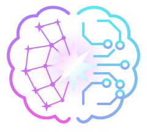

**A self-hosted, open-source workspace of AI teammates for Linux, inspired by Grok Bot.**

Version **0.1.2** · [MIT License](LICENSE) · [github.com/avitwil/stellarcortex](https://github.com/avitwil/stellarcortex) · Website: [stellarcortex.avitwil.io](https://stellarcortex.avitwil.io)

Create bots when you need them, talk to them, let them delegate work to each other, and follow their conversations and results. Each bot can use its own provider and model: a provider account, an API key, or a local model server you already run.

**Contents:** [Features](#features) · [Requirements](#requirements) · [Installation](#installation) · [Ways to run it](#ways-to-run) · [First run](#first-run) · [Accounts and models](#models) · [Provider terms](#provider-terms) · [Tools and voice](#tools) · [Bot computers](#computer) · [Configuration](#configuration) · [Data and security](#data) · [Updating](#updating) · [Troubleshooting](#troubleshooting) · [Documentation](#documentation) · [Development](#development) · [License](#license)

<a id="features"></a>
## Features

### Bots you talk to

Create bots when you need them, and edit, delete or restore them. Each bot keeps its memory, files, skills and routines. Choose a provider, model, reasoning effort and speed for each bot in the picker next to the message box, where the provider and model support them. Changes apply to the next task. When a bot needs your decision, the chat shows it and waits.

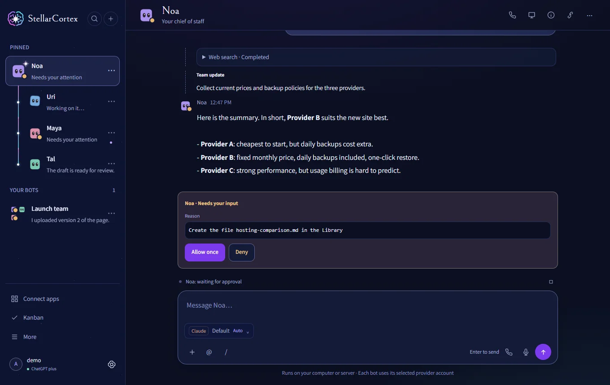

To start, press **+** at the top of the sidebar and choose **New bot**, or ask the bot you have to create a teammate.

### Teams and hand-offs

A bot can build its own team and hand work to its teammates. You see the team as a tree in the sidebar, and you can read every exchange between bots. A group conversation holds 2 to 6 bots: press **+**, choose **New group conversation** and pick the members.

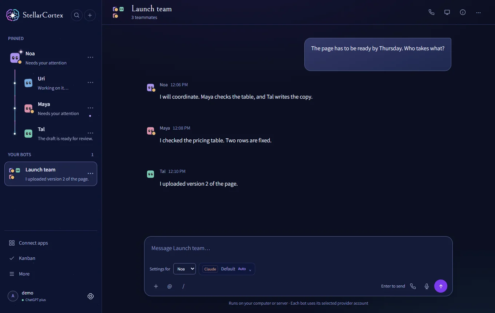

To hand work off, just ask: "Build a team for this launch and give the research to a new teammate." The block on external content follows hand-offs, as described in [Data and security](#data).

### Kanban

General and per-project boards, with task and idea stages, bot routing, approval gates, and pause and resume. Open **Kanban** in the sidebar and press **+** to add a card. Bot work on a card starts only when you start it, and automatic stage routing applies only to tasks you opted in.

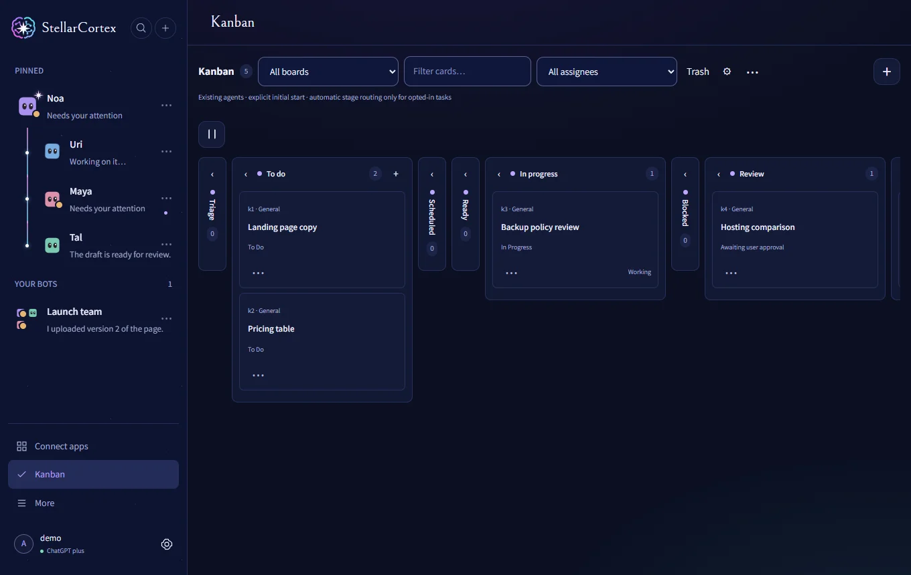

### Apps and tools

**Connect apps** adds MCP servers and the Google connector (Gmail, Drive, Docs, Sheets, Calendar and Contacts). These connections are separate from your model provider. See [Tools and voice](#tools).

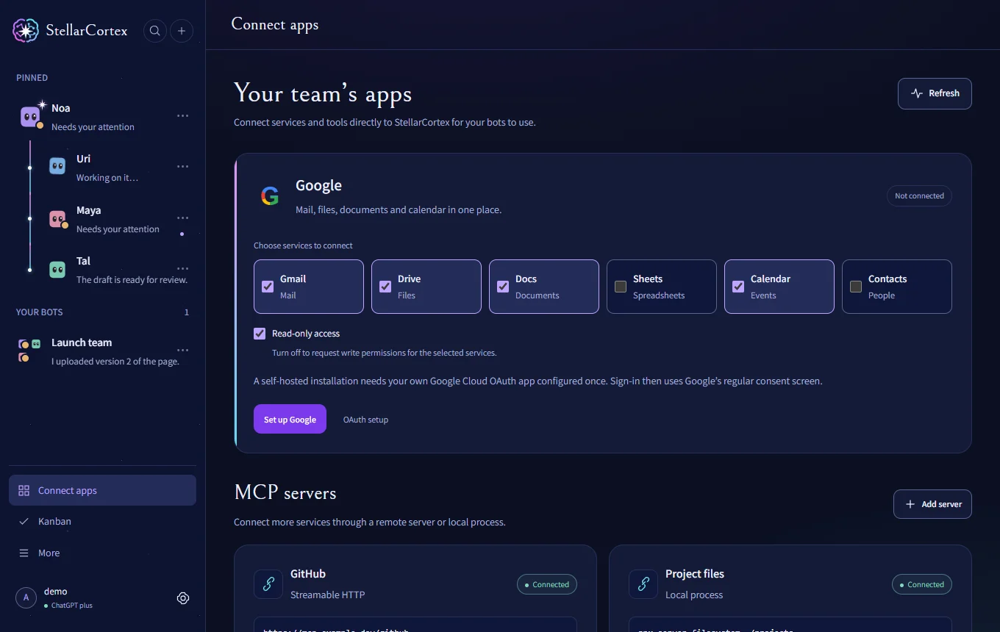

### Provider connections

Each bot can use its own connection: a provider account, an API key, or a local model server you already run. **Settings → General** holds account sign-ins, and **Settings → Models & connections** holds API providers and local models. See [Accounts and models](#models), and read [Provider terms](#provider-terms) before you connect anything.

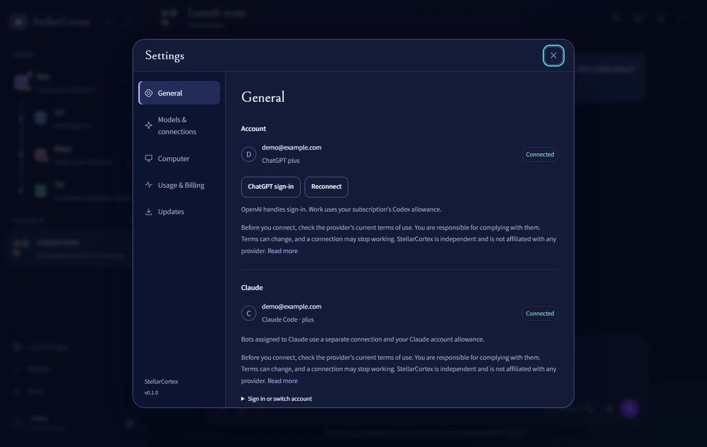

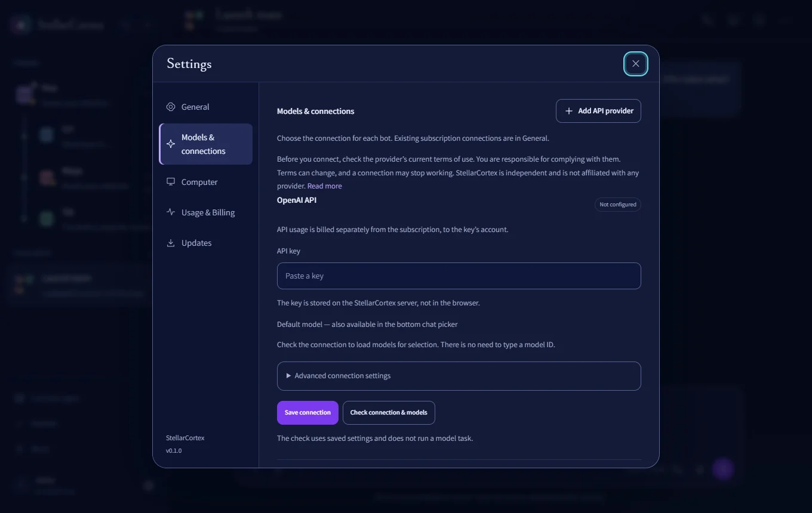

### A computer for each bot

All bots share one virtual computer, and each bot gets its own user and desktop on it. You can watch a bot's screen, take control and hand it back. Set each bot's mode in **Settings → Computer**. The chat does not depend on the computer. See [Bot computers](#computer).

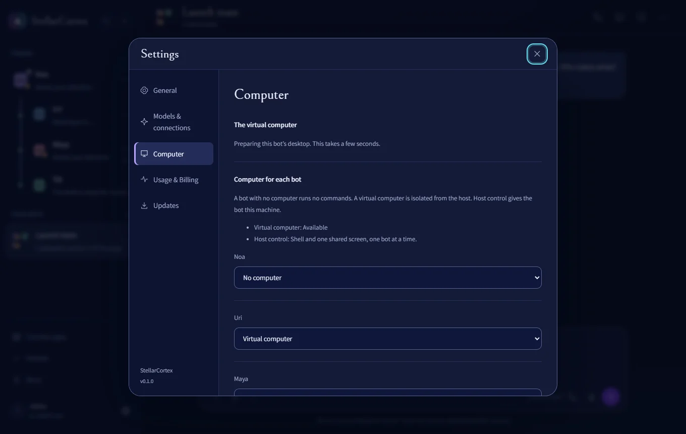

### Three designs

Choose **Observatory**, **Daylight** or **Mission control** in **Settings → General → Appearance**, in light or dark, in English or Hebrew.

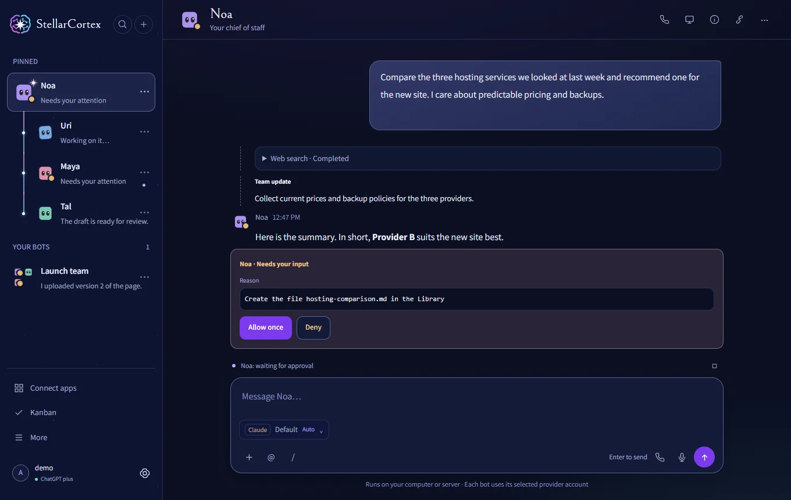

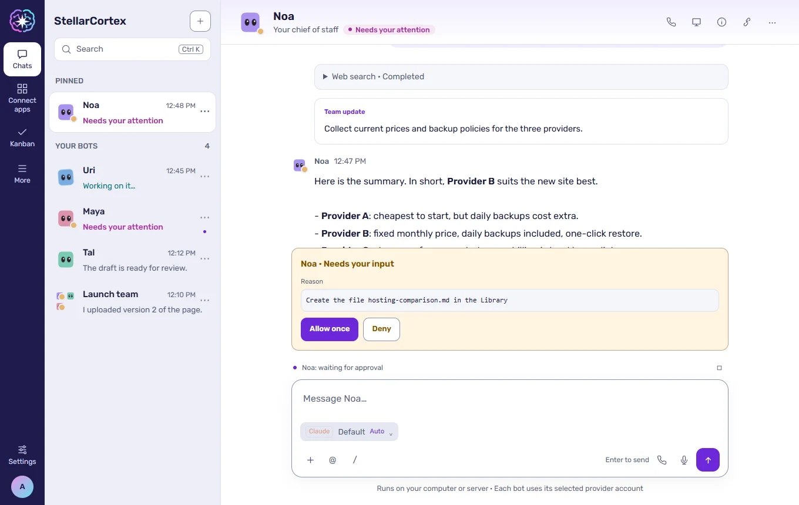

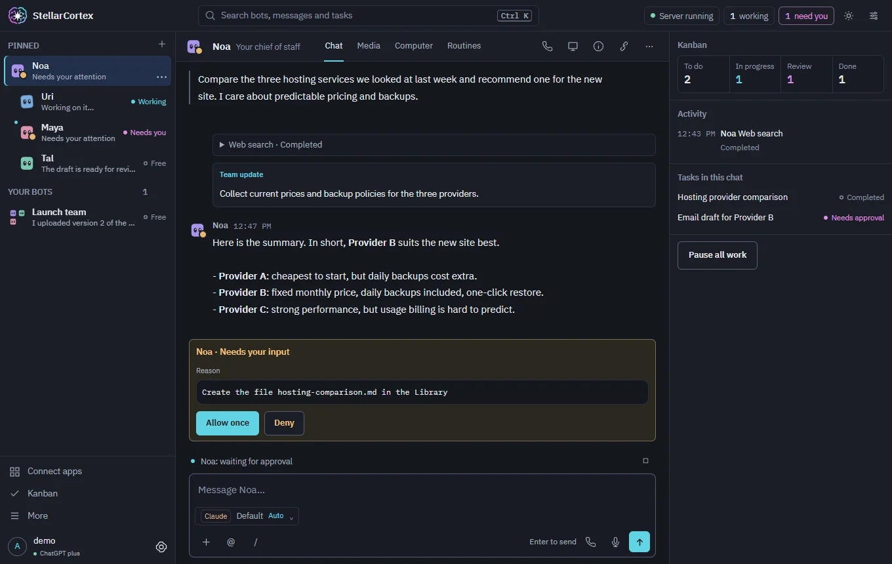

### Also included

- Memory, files, a Library, skills, routines and webhooks. Routines run while the server is running.
- A persistent browser for each bot.
- Voice calls with a bot through the microphone, in supported browsers.

StellarCortex is for one owner, not a multi-user platform. What a bot can do depends on its model, tools and permissions: tools need a model with tool calling, and screens and images need a vision model.

<a id="requirements"></a>
## Requirements

| Requirement | Details |
| --- | --- |
| Operating system | **Linux.** Version 0.1 supports Linux only, and a Windows version is planned. The instructions target Debian and Ubuntu. |
| Node.js and npm | **Node.js 22.16 or later** with npm, from [nodejs.org](https://nodejs.org/). |
| Internet | To install, and to use cloud providers and online tools. |
| Model access | At least one of: a provider account, an API key, or a running local model server. |
| Browser | A current desktop browser. Voice calls also need microphone permission and a supported audio mode. |

Which models, limits and terms apply to an account is up to the provider, and can change. API usage is billed separately, and StellarCortex never switches from a subscription to API billing on its own. Claude Code has its own [system requirements](https://code.claude.com/docs/en/setup).

The install does not add a model server or download model weights. Bots answer after you connect a model.

<a id="installation"></a>
## Installation

Run this as your regular user, not as root:

```bash
curl -fsSL https://stellarcortex.avitwil.io/install.sh | bash
```

It downloads the latest release to `~/stellarcortex`, checks its signature, installs everything and prints one link that opens the app signed in. It asks for your `sudo` password once, and one question if the host has a firewall. The virtual computer then builds in the background: the app works meanwhile, and **Settings → Computer** shows its progress. A host that cannot run the computer finishes without it and says why.

To choose settings, put them before `bash`, as the examples in [Ways to run it](#ways-to-run) show. Set `STELLARCORTEX_INSTALL_DIR` to install somewhere else.

The signature covers what the script installs, not the script itself. To check the script first, download it and compare its SHA-256 with the one in the release notes.

### Node.js

The installer needs Node.js 22.16 or later, for the whole system. If Node.js is missing, it tries your distribution's package. When that package is too old, as on Ubuntu 24.04, it stops and says so: install Node.js first, as in [step 3 of the VPS example](#run-vps).

### From source

```bash
git clone https://github.com/avitwil/stellarcortex.git && cd stellarcortex && bash install.sh --service
```

To run without a service, use `bash install.sh` and then `bash start.sh`, or `bash start.sh --no-open` on a server. If Chromium reports missing system libraries, run `sudo npx playwright install-deps chromium` in the application folder.

### Docker

```bash
docker compose up -d --build
docker compose exec stellarcortex cat /data/access-key
```

Open http://127.0.0.1:4317 and enter the key. The container runs the server only, with no desktop, and publishes the port on localhost. The Docker setup has not been tested end to end yet.

<a id="ways-to-run"></a>
## Ways to run it

| | [Your own Linux machine](#run-local) | [A VPS, over Tailscale](#run-vps) | [A local network](#run-lan) |
| --- | --- | --- | --- |
| Reached from | That machine | Your devices on your tailnet | Devices on your network |
| Connection | Localhost | HTTPS inside the tailnet | Plain HTTP |
| Bots, chat, Kanban, browser, connections | Yes | Yes | Yes |
| Microphone and the site login dialog | Yes | Yes | No: both need HTTPS or localhost |
| Virtual computer | If the host passes the [check](#computer-check) | Only if the VPS passes it, and many do not | If the host passes it |

**Never expose the port to the public internet.** Do not forward port 4317 on a router or open it in a cloud firewall. The app has no TLS of its own, and one access key opens the whole workspace. On a server with a public address, leave `STELLARCORTEX_BIND` unset, so that the app stays on `127.0.0.1`.

<a id="computer-check"></a>
### Check the host for the virtual computer

The virtual computer needs a 64-bit Intel or AMD host with KVM, at least 10 GiB of memory, 90 GiB free under `/var/lib`, `apt-get` and systemd. Many VPS plans have no nested KVM or have less memory. Check before you choose a plan, or on the host:

```bash
uname -m           # must print x86_64
ls -l /dev/kvm     # the file must exist
free -m            # "total" on the Mem line: 10240 or more
df -BG /var/lib    # "Avail": 90G or more
```

On a host that fails, the install finishes without the virtual computer and says why. Bots still chat, use their browser, memory, Library files, connections and Kanban. They have no shell and no desktop, and a Kanban validation stage needs a bot with a computer. Host control exists, but it runs a bot as the server's own user, so read [Bot computers](#computer) before you turn it on. If you fix the cause later, run `bash install.sh --service` again.

If the host has a firewall, the install asks once and adds rules for the computer's own bridge only. Your rules and SSH stay as they are. If you say no, the install finishes without the computer.

<a id="run-local"></a>
### 1. On your own Linux machine

```bash
curl -fsSL https://stellarcortex.avitwil.io/install.sh | bash
```

Open the link it prints. The service keeps running after you log out and starts with the machine. To open the app again, run `node scripts/open.mjs` in the application folder. To see the service, run `systemctl --user status stellarcortex`.

<a id="run-vps"></a>
### 2. On a VPS, reached with Tailscale

This example uses a [Hostinger](https://www.hostinger.com/vps-hosting) VPS and [Tailscale](https://tailscale.com/). Both are options we can recommend for this setup, and neither is affiliated with StellarCortex. Any Debian or Ubuntu VPS can follow the same steps. Check their current plans, prices and terms yourself.

The app stays on `127.0.0.1` and on a private socket, so no port is opened for it. Tailscale gives your own devices an HTTPS address.

1. Create a VPS with Ubuntu, and note its public address. If you want the virtual computer, choose a plan that passes the [check](#computer-check).

2. Create a regular user. The app should not run as root.

   ```bash
   ssh root@your-server-ip
   adduser stellar
   usermod -aG sudo stellar
   ```

   If you log in with an SSH key, copy it to the new user:

   ```bash
   install -d -m 700 -o stellar -g stellar /home/stellar/.ssh
   install -m 600 -o stellar -g stellar ~/.ssh/authorized_keys /home/stellar/.ssh/
   ```

   Then run `exit`, and log in again with `ssh stellar@your-server-ip`. Log in directly, not through `su`: the service needs the user session that SSH starts.

3. Install Node.js if `node --version` shows nothing or a version below 22.16. This example uses the NodeSource packages:

   ```bash
   sudo apt-get update && sudo apt-get install -y curl
   curl -fsSL https://deb.nodesource.com/setup_22.x -o nodesource_setup.sh
   sudo bash nodesource_setup.sh
   sudo apt-get install -y nodejs
   ```

4. Install Tailscale on the server and sign in through the link it prints:

   ```bash
   curl -fsSL https://tailscale.com/install.sh | sh
   sudo tailscale up
   ```

   In the Tailscale admin console, on the DNS page, turn on **MagicDNS** and **HTTPS Certificates**. Install Tailscale on your laptop or phone too, with the same account.

5. Find the server's name on the tailnet. Leave out the dot at the end.

   ```bash
   tailscale status --json | grep -m1 '"DNSName"'
   ```

6. Install StellarCortex with that name:

   ```bash
   curl -fsSL https://stellarcortex.avitwil.io/install.sh | STELLARCORTEX_TAILNET_UI_URL=https://your-machine.your-tailnet.ts.net/ bash
   ```

7. Run the `tailscale serve` command that the install prints. With the default data folder it is:

   ```bash
   sudo tailscale serve --bg --https=443 unix:/home/stellar/.stellarcortex/tailscale-ui.sock
   ```

8. Open the printed link on a device in your tailnet, and keep it private. It works only inside the tailnet.

Sign in to providers on the server, as this user. See [Accounts and models](#models).

**Already installed without Tailscale?** Do steps 4 and 5, then run this on the server. It restarts the service, which stops running tasks, and prints the command for step 7 and the link for step 8.

```bash
cd ~/stellarcortex
STELLARCORTEX_TAILNET_UI_URL=https://your-machine.your-tailnet.ts.net/ bash install.sh --service
```

**Without Tailscale.** Skip steps 4, 5 and 7, install with the plain command, and open an SSH tunnel from your computer. Then browse to http://127.0.0.1:4317 and enter the [access key](#first-run).

```bash
ssh -N -L 4317:127.0.0.1:4317 stellar@your-server-ip
```

<a id="run-lan"></a>
### 3. On a local network

Use this to reach the app from other devices at home or in a small office. It is plain HTTP, so anyone on that network can read the traffic, including the access key. Use it only on a network you trust. For HTTPS, follow the Tailscale steps on that machine instead.

1. Find the server's address, and reserve it in your router so that it does not change. The service listens on exactly this address, and it no longer answers on `127.0.0.1`.

   ```bash
   hostname -I
   ```

2. Install with that address, shown here as `192.168.1.50`:

   ```bash
   curl -fsSL https://stellarcortex.avitwil.io/install.sh | STELLARCORTEX_BIND=192.168.1.50 STELLARCORTEX_PUBLIC_URL=http://192.168.1.50:4317 bash
   ```

3. If the host has a firewall, allow your network only. With `ufw`:

   ```bash
   sudo ufw allow from 192.168.1.0/24 to any port 4317 proto tcp
   ```

4. Open the printed link from another device. Without `STELLARCORTEX_PUBLIC_URL`, the server answers "Host is not configured".

<a id="start-stop"></a>
### Start and stop it

The install adds the `stcortex` command on Linux.

| Command | What it does |
| --- | --- |
| `stcortex --start` | Starts it now, with the virtual computer. It does not change what happens at boot. |
| `stcortex --stop` | Stops it now and shuts the virtual computer down cleanly. Bots and data are kept. If it is set to start at boot, it still does. |
| `stcortex --enable` | Starts it now, with the virtual computer, and sets both to start at boot, with no login needed. |
| `stcortex --disable` | Stops both now and cancels their start at boot. |

`--enable` and `--disable` set the **Start after a reboot** switch in **Settings → Computer**, so Settings shows the result. `--start` and `--stop` do not change it.

<a id="change-settings"></a>
### Change these settings later

Run the install again with the new setting. It restarts the service, which stops running tasks, and takes a minute or two. Settings you do not repeat stay as they were. They are kept in `~/.config/systemd/user/stellarcortex.service.d/install.conf`.

```bash
cd ~/stellarcortex
STELLARCORTEX_TAILNET_UI_URL=https://your-machine.your-tailnet.ts.net/ bash install.sh --service
```

See the [deployment guide](docs/DEPLOYMENT.md#linux-service) for the data folder and port.

<a id="first-run"></a>
## First run and the access key

Open the link the install printed. To open the app again, run `node scripts/open.mjs` in the application folder.

If you are asked for a key, it is in `~/.stellarcortex/access-key`, or `/data/access-key` in Docker.

**This is your StellarCortex access key, not an API key.** It opens the whole workspace and its connections, so keep it private.

A new install starts with one bot named **Stellar**. Connect a provider in Settings, then send it a message.

<a id="models"></a>
## Accounts and models

<a id="provider-terms"></a>
### Provider terms

**Check the provider's terms before you connect.** StellarCortex can connect to accounts and services run by other companies. Before you connect any provider account, subscription or API key, check that provider's current terms of use yourself. You are responsible for complying with them.

Terms can change at any time, and a connection that works today may stop working. StellarCortex does not say that any use of a provider's account or subscription is allowed, and it does not promise that any connection will keep working.

StellarCortex is an independent project. It is not affiliated with or endorsed by any provider, and all product names belong to their owners. The software is provided "as is", without warranty of any kind, as stated in the [MIT license](LICENSE).

### Connect a provider

Sign in **in the environment and as the OS user that runs the server.** A login on your desktop does not carry over to a remote server or a container.

**ChatGPT / Codex.** The tool can use a ChatGPT account through the Codex client. In **Settings → General**, choose **Sign in with ChatGPT**, or run `node node_modules/@openai/codex/bin/codex.js login --device-auth` in the application folder. OpenAI handles the sign-in.

**Claude (Claude Code).** The tool can run the Claude Code client with your own account. In **Settings → Models & connections**, press **Connect Claude** and complete the sign-in, then choose Claude in a bot's provider picker. You can also run **`bash claude-login.sh`** in a terminal, then refresh the Claude connection in Settings. See the [provider terms note](#provider-terms). Claude Code is an optional dependency that npm downloads on your machine, under its own terms. See the [Claude guide](docs/CLAUDE.md).

**API providers and local models.** In **Settings → Models & connections → Add API provider**, choose a preset (OpenAI, Anthropic, NVIDIA, OpenCode and others) or a custom endpoint using Chat Completions, Responses or Anthropic Messages, and enter the key. For a local model, choose **Ollama, llama.cpp, LM Studio or vLLM** and enter the address of a server you already run. The address must be reachable **from the StellarCortex server**: inside Docker, `localhost` means that container. Connections you configure can use loopback, LAN and tailnet addresses; cloud metadata addresses are always refused. See the [API and local model guide](docs/API-LOCAL.md).

Choose each bot's model, effort and speed in the picker next to the message box; changes apply to the next task. See the [model settings guide](docs/MODELS.md).

<a id="tools"></a>
## Tools and voice

**Connect apps** adds MCP servers over Streamable HTTP, SSE or a locally installed stdio program, with no authentication, a key or header, or OAuth. HTTP and SSE servers can be on loopback, your LAN or a tailnet; cloud metadata addresses are always refused. The Google connector covers Gmail, Drive, Docs, Sheets, Calendar and Contacts; it needs your own Google OAuth client. See the [connections guide](docs/CONNECTIONS.md).

Set the language in **Settings → General → Language**. The call button starts a voice conversation with the selected bot, using the browser's speech recognition and synthesis or OpenAI Realtime (API key, billed separately). It needs microphone permission over localhost or HTTPS. See the [voice guide](docs/VOICE.md).

<a id="computer"></a>
## Bot computers

All bots share one virtual computer, an Ubuntu guest on QEMU/KVM, and each bot gets its own user and desktop on it. The chat does not depend on the computer: a bot answers while it builds or restarts. The computer's memory limits how many bots get a desktop, and a bot past the limit chats as usual. The computer starts by itself after a host reboot, unless you turn that off in **Settings → Computer**.

Set a bot's mode in **Settings → Computer**, while it has no work running.

| Mode | What the bot gets |
|---|---|
| **No computer** | The browser, memory, Library files and connections. No shell and no desktop. |
| **Virtual computer** | Shell, files, browser and desktop inside the guest, as a separate unprivileged user. |
| **Host control** | Shell and screen on this machine. **The bot runs as the server's OS user, so it can read private keys, the access key and browser cookies.** Use it only if you accept that. |

In the computer viewer, expand the screen, choose **Take control** to use your mouse and keyboard, and **I'm done** to hand control back.

**Logging in to a site.** When a bot reaches a login page, it can ask you to log in. A dialog shows the site's real address, and the password goes to the page and is not saved. Read the address before you type. Never type a password in the chat.

See [COMPUTER.md](docs/COMPUTER.md).

<a id="configuration"></a>
## Configuration

Settings are environment variables. With a service install, put them before the install command.

| Variable | Default | Purpose |
| --- | --- | --- |
| `STELLARCORTEX_DATA_DIR` | `~/.stellarcortex` | Data folder: state, workspace, browser profiles, access key, logs |
| `PORT` | `4317` | HTTP port |
| `STELLARCORTEX_BIND` | `127.0.0.1` | Listen address. It adds no TLS |
| `STELLARCORTEX_PUBLIC_URL` | none | The address you open in the browser, behind a reverse proxy or on a LAN. An HTTPS address enables secure cookies |
| `STELLARCORTEX_TAILNET_UI_URL` | none | Your Tailscale HTTPS address |
| `CODEX_BIN`, `CLAUDE_BIN` | bundled clients | Use a different Codex or Claude Code executable |

See the [deployment guide](docs/DEPLOYMENT.md) for reverse proxies and other setups.

<a id="data"></a>
## Data and security

- One installation is for one trusted owner. Keep the access key, the data folder and the OS account private.
- Instructions come only from you or other bots in the tool. Mail, MCP output, webhook payloads, web pages and desktop screens are data. Once a bot reads them, shell commands and file changes are blocked for that conversation. To run commands again, clear the conversation or use another one. See [permissions and updates](docs/UPDATES.md).
- Elevation commands such as `sudo` are refused for every bot, as far as the app can detect them.
- Provider credentials are encrypted in the data folder. Codex and Claude logins are stored by their own clients.
- The server listens on localhost. For remote access, use Tailscale, an SSH tunnel, or a reverse proxy with HTTPS. See [Ways to run it](#ways-to-run). Never expose the port to the internet.
- **Backup:** stop the server and copy the whole data folder. The JSON export in the interface is not a complete backup.

<a id="updating"></a>
## Updating

Open **Settings → Updates**. It checks for a newer release and compares it with your version. If there is one, it shows the version and its notes and an **Update now** button, then the progress and the result. If the check fails, it shows why and a **Check for updates** button.

The app checks the release's signature against a key fixed in your install, and refuses a release that fails or is not newer. It backs up your data, starts the new version and checks it. If that check fails, the previous version and data come back, and Settings shows why. Your data and sign-ins are kept. The virtual computer's system parts update in the same step.

If the button is not available, as in Docker, see [Recovery](docs/RECOVERY.md).

<a id="troubleshooting"></a>
## Troubleshooting

| Problem | What to check |
| --- | --- |
| `node` or `npm` not found | Install Node.js 22.16+ and open a new terminal. |
| The interface does not open | Start with `bash start.sh`, then check `server.log` in the data directory. |
| Port 4317 is in use | Stop the other instance, or use a different `PORT` and `STELLARCORTEX_DATA_DIR`. |
| The app asks for a key | Run `node scripts/open.mjs`, or read the `access-key` file. On a remote server the key is on the server. |
| Codex or Claude shows disconnected | Sign in on the server as the same OS user, check eligibility and quota, then refresh in Settings. |
| Chromium is missing or will not start | Run `node node_modules/playwright/cli.js install chromium`; on Debian/Ubuntu also `sudo npx playwright install-deps chromium`. |
| A bot has no desktop | Check its mode in **Settings → Computer**. Host control needs an X11 session. |
| The computer stops with "no network address" | The host firewall blocks it. Run `sudo python3 /var/lib/stellarcortex/kit/deployment/ubuntu-desktop/network-coexistence.py --install`, then press **Retry** in **Settings → Computer**. |
| The local model is unreachable | Check that it runs and is reachable from the server. |
| An MCP connection is saved but inactive | Connect it in Connect apps. MCP servers do not reconnect automatically after a restart. |
| Microphone or audio does not work | Check permission, browser support and localhost/HTTPS. Realtime needs an OpenAI API connection. |

`npm run doctor` checks the installation and connection status. It does not prove that a model will answer; send a short test message for that. Review its output before sharing it.

<a id="documentation"></a>
## Documentation

| Guide | Language |
| --- | --- |
| [Deployment: services, SSH, HTTPS, Tailscale, backups](docs/DEPLOYMENT.md) | English |
| [Computer control and separate screens](docs/COMPUTER.md) · [Shared Ubuntu computer](docs/SHARED-DESKTOP.md) · [Host installation](deployment/ubuntu-desktop/README.md) | English |
| [Permission modes and updates](docs/UPDATES.md) | English |
| [Feature map](docs/PARITY.md) · [Testing and validation](docs/VALIDATION.md) · [Roadmap](docs/ROADMAP.md) · [Visual system](docs/DESIGN.md) | English |
| [Third-party notices and licenses](THIRD_PARTY_NOTICES.md) | English |
| [Models, effort and speed](docs/MODELS.md) · [Claude Code and usage](docs/CLAUDE.md) · [API and local models](docs/API-LOCAL.md) · [MCP and Google](docs/CONNECTIONS.md) · [Voice](docs/VOICE.md) | English, Hebrew |

<a id="development"></a>
## Development

```bash
npm ci
npm test            # Node test suite
npm run lint        # formatting (Prettier, black) and ruff
npm run format      # applies the formatting
```

Some tests need Linux. See [Testing and validation](docs/VALIDATION.md). To publish a version, see [Releasing](docs/RELEASING.md).

<a id="license"></a>
## License

[MIT](LICENSE). The software is provided "as is", without warranty of any kind. StellarCortex is an independent project and is not affiliated with or endorsed by xAI, OpenAI, Anthropic or any other provider. Bundled files, dependencies and downloaded software keep their own licenses and terms: see [THIRD_PARTY_NOTICES.md](THIRD_PARTY_NOTICES.md). Some are not open source, and they stay installed from their own source on your machine. Check [Provider terms](#provider-terms) before you connect a service.

## Version history

**0.1.2** — the new `stcortex` command starts and stops the tool and its virtual computer, and sets what happens at boot. Tailscale can be added after an install with one command. The install output is clearer: it says when the signature is verified, apt stays quiet unless it fails, and the firewall question stands out.

**0.1.1** — the virtual computer now works on hosts with a firewall. The install finds nftables, ufw, firewalld or iptables, asks once and adds rules for its own bridge only. A computer that gets no network stops with a clear message and the fix. A small check restores the network guard if a firewall reload removes it.

**0.1.0** — first public release: multi-provider bots (Codex, Claude Code, API and local models), team hand-offs, memory, skills, routines and webhooks, Kanban projects, MCP and Google connections, voice calls, a computer mode for each bot (none, a virtual computer on KVM, or host control), per-bot permission policy, and GitHub update checks.
